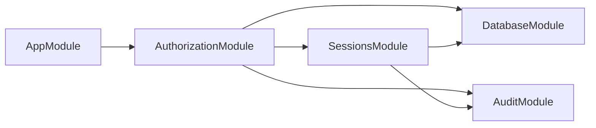
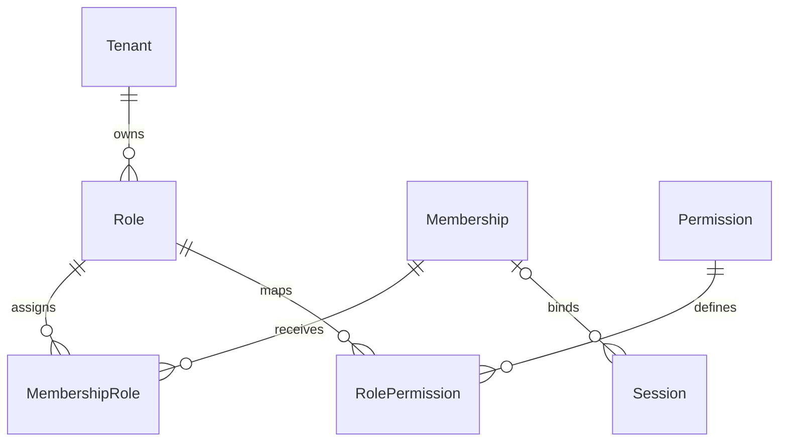

# RBAC and trusted tenant context — Task 2.5

Task 2.6 preserves this RBAC/owner model with restricted-role RLS. Authorization
revalidates runtime WeakMap proof/current session state before transaction-local
tenant binding; owner counting can see the complete eligible tenant owner set.
Role provisioning is also exported through RoleProvisioningModule for the separate
controlled CLI without an application database pool. See [RLS](RLS.md); earlier
RLS deferral statements below are historical Task 2.5 boundaries.

## Implemented boundary

AuthorizationModule is non-global and exports AuthorizationService and the
separate bootstrap-only RoleProvisioner. It imports DatabaseModule, SessionsModule
and AuditModule. Sessions does not import Authorization. TenantAuditWriter uses
only an erased type import from the standalone catalog, so there is no runtime
module cycle. AppModule explicitly imports AuthorizationModule. No controllers,
resolvers, transport guards, custom roles, platform elevation, business resources,
RLS policies or PostgreSQL roles are introduced. Task 2.6 has not started.

Role means a predefined tenant-owned bundle, Permission a closed system-defined
capability, MembershipRole a retained assignment interval, and RolePermission a
mapping constrained to tenant scope. Global users have no tenant role field.

## Persistence and database guarantees

| Model          | Fields / keys                                                                                                                                                               |
| -------------- | --------------------------------------------------------------------------------------------------------------------------------------------------------------------------- |
| Role           | UUIDv4 id, tenantId FK, enum code, display name varchar80, templateVersion1, ACTIVE/INACTIVE status, createdAt/updatedAt; unique (tenantId,code), unique (tenantId,id)      |
| Permission     | stable code varchar80 primary key, TENANT scope, description varchar200; unique (code,scope)                                                                                |
| MembershipRole | UUIDv4 id, tenantId, membershipId, roleId, grantedAt, nullable granting actor, removedAt/removing actor; tenant-aware FKs to Membership and Role; restricted actor User FKs |
| RolePermission | primary key (tenantId,roleId,permissionCode); same-tenant Role FK and (permissionCode,scope) FK to catalog                                                                  |

All new timestamps use timestamptz(3). Existing PostgreSQL UUIDv4 generation is
retained. Display names confer no authority; code/version/mappings are predefined
semantics with no mutation API. No custom code can be stored in Role's enum.
Prisma updates updatedAt on Prisma writes; direct SQL must maintain it explicitly.

MembershipRole keeps removed rows. A partial unique index on
(tenantId,membershipId,roleId) WHERE removedAt IS NULL prevents duplicate current
assignments. Removal records actor/time; reassignment creates a new row, preserving
old intervals and audits. Removal cannot precede granting, and removing actor/time
must be populated together. Initial owner bootstrap may use a null grant actor;
ordinary operations always record the verified actor.

Composite FKs reject cross-tenant membership-role and role-permission links.
RolePermission's scope CHECK plus catalog composite FK prevent platform grants,
including after a future enum expansion unless a separately reviewed migration
changes those constraints. The catalog CHECK permits only the five current codes.
Owner roles cannot be marked INACTIVE, even during pending provisioning (a
deliberately stricter rule). All nine new FKs use UPDATE/DELETE RESTRICT.

Actor eligibility/delegation, immutable semantics through supported APIs and the
eligible-owner invariant are service-enforced. These are not universal defenses
against unrestricted database administrators or external SQL writers.

## Exact permission catalog and role matrix

| Code                      | Meaning                                                                                                                 |
| ------------------------- | ----------------------------------------------------------------------------------------------------------------------- |
| tenant.memberships.read   | Tenant-local membership reads only; never discovery of unrelated global memberships                                     |
| tenant.memberships.manage | Tenant-local membership lifecycle changes; never global User suspension; owner targets also require ownership authority |
| tenant.roles.read         | Read the current tenant's predefined roles                                                                              |
| tenant.roles.assign       | Assign/remove eligible non-owner roles within the actor's delegation ceiling                                            |
| tenant.ownership.manage   | Owner assignment/removal and owner membership changes, subject to eligibility and last-owner protection                 |

These are capabilities, not implemented listing endpoints. The system catalog is
inserted by migration; no application startup seed executes. No shipment, finance,
warehouse or platform permission is active.

| Template           | memberships.read | memberships.manage | roles.read | roles.assign | ownership.manage |
| ------------------ | ---------------- | ------------------ | ---------- | ------------ | ---------------- |
| OWNER              | yes              | yes                | yes        | yes          | yes              |
| ADMIN              | yes              | yes                | yes        | yes          | no               |
| DISPATCHER         | no               | no                 | no         | no           | no               |
| WAREHOUSE_OPERATOR | no               | no                 | no         | no           | no               |
| FINANCE_OFFICER    | no               | no                 | no         | no           | no               |
| COURIER            | no               | no                 | no         | no           | no               |
| MERCHANT           | no               | no                 | no         | no           | no               |

The five columns refer exactly to the tenant-prefixed codes above. Future business
templates deliberately start with no grants. OWNER has no implicit financial or
universal power. Effective grants require actual persisted mappings **and** the
compiled template ceiling; a role label alone grants nothing. Unknown permission
strings, wildcards and unsupported mappings are denied even if injected into a
mapping by unrestricted SQL.

## Provisioning and ownership bootstrap

`RoleProvisioner.provisionIn(tx, tenantId, correlationId)` is a trusted bootstrap
transaction API, separate from administrative role assignment. It locks the tenant,
checks the system catalog, creates missing predefined roles only for PENDING
tenants, and audits once when rows are created. Repetition with identical semantics
is idempotent. Existing mapping/version drift throws rather than silently repairing
or overwriting it. Provisioning does not reactivate inactive ordinary roles.

No tenant, user, membership or owner is created in development, on startup, or by
this provisioning method. No public owner bootstrap exists. Future onboarding
must create tenant, templates, initial eligible membership and owner assignment,
verify the invariant, then activate the tenant **in the same transaction**. Pending
tenants may be ownerless while provisioning; active tenants may not. Existing
tenants requiring remediation must stop for explicit owner review. Both actual
databases contained no tenant records at preflight, so no remediation was needed.

## Trusted context and permission resolution

Identity sessions have no tenant authority. Explicit tenant selection creates a
TENANT session with tenantId and membershipId, then `resolve(accessToken, tenantId)`
validates the current session and selected membership before returning a context.
An identity-only token cannot mint a tenant context from a selector alone.

The frozen context contains userId, sessionId, tenantId, membershipId,
contextVersion and a frozen permission snapshot. Its constructor is not exported.
A private runtime WeakMap binds the exact object to its validated access credential;
copies, deserialized objects, arbitrary actor IDs and forged permission arrays
are rejected. TypeScript interfaces alone are not trusted. The credential is never
an enumerable context field, logged, persisted or returned by authorization APIs.
WeakMap state lasts only while the context is referenced; contexts are request
capabilities, not reusable distributed caches. Other app instances resolve their
own context from the credential.

Every check revalidates the current session/user/tenant/membership/version and
reloads active assignments, ACTIVE version1 roles and tenant-scoped mappings from
PostgreSQL. Permission union is deduplicated and bounded by the closed catalog.
The snapshot is informational and never the authoritative input to a later check.
ACTIVE verified user, ACTIVE membership and ACTIVE tenant are required. Inactive
roles or removed grants yield no permissions; Redis caches no authority.

Methods: resolveEffective, has, require and checkSet. Unknown/empty/malformed
requirements deny. checkSet explicitly selects all-of or any-of and bounds input
length; all-of on an empty array does not authorize. Callers supply the expected
resource tenant ID, which must match the minted context, preventing accidental
cross-tenant context reuse. Invalid selectors receive generic results, not
unrelated tenant membership information.

`requireIn(tx, context, tenantId, permission)` composes fresh RBAC checks with a
future resource policy and actual write in the same transaction. Separate `has`
or `require` calls authorize only their own database observation point, not a later
unprotected business write. Future resource operations must use the transactional
boundary and explicit tenant predicates/resource locks.

## Session integration and owner-approved transition rule

Session gains nullable tenantId/membershipId and scope TENANT. A CHECK requires
both fields null for IDENTITY or both present for TENANT. A composite FK
(tenantId,membershipId,userId) references Membership's matching triple, preventing
user/member/tenant mismatch. A separate Tenant FK and lookup index are included.
Existing identity-only records stay null/unbound. RefreshToken gains positive
contextVersion, backfilled from its session, preserving previous identity state.

Owner explicitly chose **both current access and refresh credentials from the same
eligible session/current context** for internal selectTenant. No public transport
or header-based tenant selection exists.

The operation verifies purpose/format and matching session IDs; locks current user,
session, relevant tenant rows, membership rows and refresh; checks current expiry/
eligibility/version; consumes the old refresh; increments contextVersion; binds the
selected eligible membership; issues new tokens; audits the destination tenant;
then commits before returning credentials. Absolute lifetime is unchanged and
idle/access/refresh clipping retains Task2.4 policy.

Old access tokens cannot authorize the new context. Old consumed refresh tokens
retain strict replay revocation; unconsumed wrong-version refreshes are rejected
without restoring any context. A duplicate transition with a still-unexpired
matching old access token and consumed refresh is handled as replay **before**
the stale-version grant check; it grants no context and revokes the session.
There is no grace window. Concurrent transition/refresh therefore yields one
issuance then replay revocation, including the winner's credentials. Clients must
single-flight both refresh and context changes and reauthenticate after lost or
ambiguous responses. Revocation races leave credentials unusable.

Session validation/refresh now also check bound tenant/member eligibility.
Suspension/removal immediately blocks that tenant session. No automatic switch
to another tenant occurs; a new identity authentication flow is future work.
Existing identity-only session, replay, lifetime and revocation tests remain intact.

## Delegation, membership changes and last-owner protection

Ordinary changes accept a runtime-minted actor context, never an arbitrary actor
ID. The mutation transaction revalidates authority before touching the target.
Target membership and role are looked up only in the actor's tenant; assignments
require active, verified target users and ACTIVE memberships/roles.

For non-owner roles the actor needs roles.assign and every permission in the
target template ceiling. OWNER additionally requires ownership.manage. ADMIN
cannot grant/remove OWNER or mutate an owner membership. All self-assignment is
denied, including repeated self-assignment; self-removal/demotion is allowed only
when ownership remains valid. Other authorized existing grants/missing removals
are idempotent. Inactive role targets are not administratively reassigned/removed
through this initial API; a future lifecycle design must review cleanup semantics.

Membership status mutation requires memberships.manage, plus ownership.manage
for owner memberships. It changes only Membership, never User. Removed-to-suspended
is rejected; removed-to-active reuses the row, clears removedAt and does not
resurrect removed role grants. Suspension preserves assignments but eligibility
denies their use. Removal closes all active assignment intervals transactionally.
Explicit reactivation can make an unrevoked, unexpired bound session eligible again;
revocation is a separate operation. Removed grants are never resurrected implicitly.

An eligible owner is an ACTIVE verified User, ACTIVE Membership, active unremoved
OWNER assignment and ACTIVE version1 OWNER role with persisted ownership.manage.
Every supported role/status mutation checks that an ACTIVE tenant retains at least
one such owner. Multiple owners are supported. An invalid final count throws inside
the transaction, rolling back both state/history changes and any audit writes.

Future global User suspension/deactivation or email-verification removal must lock
that user, discover every affected tenant from trusted state, lock tenants in
stable order and assert the invariant with the proposed state before committing.
Future tenant activation/owner-role/mapping changes must also integrate the check.
Those global lifecycle workflows are not implemented. SQL administrators can
bypass service invariants; no global trigger/RLS/permission enforcement is claimed.

## Transactions, ordering and concurrency

READ COMMITTED, maxWait1000ms, timeout5000ms and local lock_timeout750ms remain.
Existing Prisma pool5/statement2s/query3s settings are unchanged. No retries of
ambiguous outcomes or in-process mutex is used. No expensive external operation
is performed inside these transactions.

Extended order: User -> Session -> Tenant (IDs sorted when selecting across
contexts) -> Membership -> RefreshToken. This preserves the Task2.4 relative
User/Session/Refresh order. Sessions and authorization reads take shared tenant/
membership locks. Authorization mutations acquire Tenant FOR UPDATE on the first
validation, avoiding shared-to-exclusive tenant lock upgrades between two admins.
The tenant row serializes assignments, membership status and owner counts.
Different tenants can progress independently. Provisioning takes only its tenant
lock and no user/session locks; future multi-user lifecycle writers must order
their user/tenant sets consistently before state changes.

Actual independent PostgreSQL application pools test owner-removal races,
owner-removal versus suspension, assignment versus member removal, current actor
authority changing concurrently, context selection versus refresh/revocation,
simultaneous selections and bounded tenant lock contention. Authorization is
linearized at the transaction's current-state check. It does not retroactively
cancel requests already authorized/executing. Future business writes need the
same-transaction resource policy boundary, not a cached permission result.

## Audit policy and remaining resource-level boundaries

TenantAuditWriter reuses AuditModule/AuditEvent. Events: roles_provisioned,
role_assigned, role_removed, membership_status_changed and context_selected,
prefixed `tenant.`. Owner changes are role events with the explicit OWNER code.
All use TENANT scope, destination/current tenant FK, verified actor UUID for
ordinary operations, valid server correlation and constructed target UUIDs.
Provisioning is a null-actor system event. Metadata is only count, role code or
membership status; context changes include no previous tenant information.

Successful mutations and audits commit together. Ordinary denied/random attempts
create no unbounded durable audit stream; last-owner rejections roll back their
attempted mutation. Required refresh replay revocation/audit still commits before
failure reporting using Task2.4's global session-security audit namespace and null
system actor. No token/digest/password or request body enters metadata/logs. Audit
retention/access/immutability controls remain future work.

Tenant-wide permission is necessary but insufficient for future merchant-owned
resources, courier-assigned deliveries, warehouse-location access, financial
authority/dual control and shipment state transitions. Compose those resource
predicates, current assignments and business invariants after requireIn within the
same transaction; never infer ownership from MERCHANT/COURIER labels or grant
every shipment in the tenant. No such resources or operational grants exist now.

## Migration and verification

Fourth migration 20261126220000_rbac_tenant_context adds four RBAC tables, three
enums, TENANT session scope, session reference fields, refresh version, composite
keys/FKs, fifteen indexes including primary keys and seven custom CHECKs. It seeds
only five system Permission rows; no tenant roles/users/owners are auto-created.
Existing migrations remain unchanged. Reviewed SQL uses a transaction and text
scope comparisons so the added enum label is not used as an enum literal before
commit. Generated from prior/current Prisma schemas without shadow database.

Guarded target/history/schema/data verification and all 324 baseline tests preceded
implementation. Test database migration/tests precede rechecked development
deployment. No reset, db push, extension, privilege/credential change or RLS.
See PROGRESS.md for exact final counts, times, hashes and infrastructure evidence.

Manual verification: activate Node24; run db:validate, db:generate, typecheck, lint,
format:check, npm test, test:db, redis:test:inspect/test:redis and build. Focused
real checks: `npm run test:db -- --testPathPatterns=authorization.database-spec`.
Tests provision only synthetic run-owned tenants, bootstrap owners atomically,
and clean only their exact IDs/correlations; global catalog rows remain intact.
Never dump tokens or private runtime proofs. No public administrative verification
endpoint exists. GitHub Actions has not been run by this agent.

RLS is explicitly Task2.6 and remains unimplemented. Transport guards, Auth flows,
client credential handling, compromised-password screening, resource policies,
platform administration, monitoring/capacity and existing deployment restrictions
remain unresolved. No production readiness is claimed.
