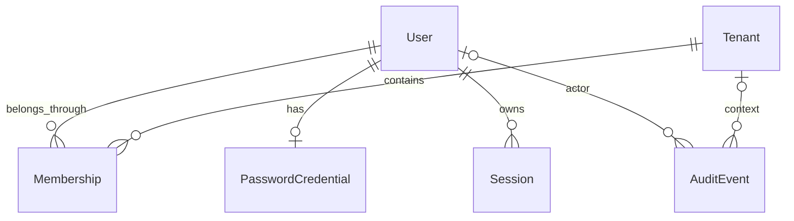

# Core identity database foundation — Tasks 2.2 through 2.5

## Boundary and approved direction

User, Tenant, Membership, AuditEvent and PasswordCredential persistence is implemented. There
are no public identity, session or role-management endpoints,
invitations, onboarding services or RLS policies. All access remains through the
existing singleton PrismaService exported by the non-global DatabaseModule.

Task 2.3 adds internal Argon2id password services through non-global IdentityModule,
with no credential workflows. See [password architecture](PASSWORDS.md) for the
credential schema, policy, dependency assessment, capacity, rehash strategy and
actual benchmark. The original core identity migration remains unchanged.

Task 2.4 adds Session, AccessToken and RefreshToken persistence with internal
identity-only session operations, strict rotation/replay handling and safe audit
writing. See [session architecture](SESSIONS.md) for schemas, eligibility, lifetime
policy, database locks and future trusted Auth integration. No tenant authorization
is granted by these contexts. Both prior migrations remain unchanged.

Approved direction: global human identities with multiple company memberships;
globally unique email login initially and phone authentication later; both
platform-controlled onboarding and self-service company registration; multiple
owners with at least one remaining; PostgreSQL opaque sessions; shared tables
with tenant-aware constraints and staged RLS; predefined multiple roles per
membership, with custom roles later; deactivation and necessary history
preservation. These are future requirements, not implemented capabilities.



Task 2.5 adds tenant-owned predefined roles and role assignments, effective
permissions, service-enforced eligible-owner protection and trusted tenant-bound
session context. See [authorization architecture](AUTHORIZATION.md) for the exact
matrix, composite constraints, delegation and future global lifecycle obligations.

## Fields and lifecycle

All IDs are native UUIDs, generated by PostgreSQL `gen_random_uuid()` (v4) for
both Prisma and direct SQL. No extension is needed. Correlation IDs use native
UUIDs consistent with existing server-assigned request correlation. All times
use `timestamptz(3)`; local database/session timezone is UTC and JavaScript exposes
Date instants. PostgreSQL retains instants, not an original timezone label.

| Entity     | Fields and defaults                                                                                                                                                                    |
| ---------- | -------------------------------------------------------------------------------------------------------------------------------------------------------------------------------------- |
| User       | id; email varchar(254), case-preserved original display value; canonicalEmail varchar(254), globally unique; status PENDING; nullable emailVerifiedAt; createdAt/updatedAt             |
| Tenant     | id; name varchar(200); unique slug varchar(100); status PENDING; createdAt/updatedAt                                                                                                   |
| Membership | id; required userId/tenantId; status ACTIVE; joinedAt (first join); nullable removedAt; createdAt/updatedAt                                                                            |
| AuditEvent | id; nullable actorUserId/tenantId; required scope, action varchar(100), targetType varchar(80), outcome, correlationId; nullable targetId varchar(128), metadata jsonb; createdAt only |

Creation/join times default to database now. Prisma maintains `updatedAt` for
Prisma writes; direct SQL writers must explicitly maintain it. There is no update
trigger. Verification timestamps represent recorded verification only; no process
currently verifies ownership. Other status-transition timestamps and transition
policies are deferred rather than invented.

User states: PENDING, ACTIVE, SUSPENDED, DEACTIVATED. Tenant states: PENDING,
ACTIVE, SUSPENDED, CLOSED. Membership states: ACTIVE, SUSPENDED, REMOVED.
Initial pending user/tenant status confers no authorization or verification.
Membership ACTIVE represents a relationship, not an authorization grant.

Email and slug uniqueness continues after deactivation/closure; this task creates
no release/reuse workflow. Owner approval and a later reviewed migration/use case
are needed before changing those policies. There is no automatic deletion.

Membership `(tenantId,userId)` is unique across all lifecycle states. Future
reactivation must reuse the same row, clear removedAt and preserve first joinedAt;
the future transactional service must record the transition in audit history.
This task tests database support, but creates no reactivation workflow or automatic
audit writer. Membership changes do not change User or Tenant lifecycle state.

## Canonical email contract

The authoritative expression is:

```sql
lower(btrim(display_email, E' \t\n\r\f\013') COLLATE "pg_unicode_fast")
```

Trim exactly outer ASCII SP, HT, LF, CR, FF and VT; preserve original display
email separately. Apply PostgreSQL 18 Unicode full lowercase mapping, then compare
canonical values byte-exactly under column `COLLATE "C"`. A named CHECK rejects
empty canonical values and any mismatch, including writes outside Prisma.
Uniqueness uses that same column collation. No provider-specific dot/plus rewriting,
Unicode normalization, domain rewriting or case folding beyond lowercase occurs.
Do not substitute locale-dependent lowercasing or assume JavaScript trim/lowercase
is identical for every Unicode input. Future validation must use this expression
or prove equivalence with Unicode edge-case tests before storing the result.

This deliberately avoids dependency on the cluster's en_US locale or ICU version.
`pg_unicode_fast` must exist and the database must use UTF8 (verified locally).
Re-evaluate case-mapping changes before a PostgreSQL major upgrade. PostgreSQL
documents its [built-in collation semantics](https://www.postgresql.org/docs/18/collation.html).
Full address syntax, SMTP internationalization support, length-by-byte validation,
ownership verification, abuse controls and email changes remain application work.
The CHECK establishes normalization consistency, not email deliverability.

## Constraints, indexes and referential actions

Prisma declares primary/unique keys, enums, lengths, nullability and foreign keys.
Every FK uses ON DELETE RESTRICT and ON UPDATE RESTRICT, preserving parent
references and history. There is no destructive cascade or silent actor erasure.
Privacy/anonymization and eventual deletion require a separately reviewed policy.

| Entity     | Additional constraints and indexes                                                                                                                                                            |
| ---------- | --------------------------------------------------------------------------------------------------------------------------------------------------------------------------------------------- |
| User       | unique canonicalEmail; SQL canonicalEmail check and C collation                                                                                                                               |
| Tenant     | unique slug; SQL nonblank name; lowercase ASCII alphanumeric slug segments separated by single hyphens                                                                                        |
| Membership | unique (tenantId,userId); unique (tenantId,id) for future composite FKs; indexes (userId,status), (tenantId,status,id); SQL REMOVED iff removedAt is nonnull; removal cannot predate joinedAt |
| AuditEvent | indexes (tenantId,createdAt,id), (actorUserId,createdAt,id), correlationId; SQL scope, identifier and metadata checks                                                                         |

All eight named CHECK constraints and the canonical column collation live in the
reviewed SQL migration because Prisma cannot express them. Real catalog tests
verify their presence/validation, keys, indexes and FK actions; migration checksum
verification and Prisma schema diff complement behavior tests. Never remove these
custom clauses when generating later migrations.

Tenant-owned Membership always has tenantId. Future tenant-owned references must
use composite FKs to `(tenantId,id)` where applicable. These keys alone do not
authorize queries or establish complete tenant isolation. Trusted identity,
tenant-scoped services, negative cross-tenant tests and dedicated RLS verification
are required before tenant-data APIs are exposed.

## Minimum audit semantics and limits

Scope is TENANT iff tenantId is present; PLATFORM requires no tenant. A null actor
means system-generated in either scope, independently of the namespace. A known
human actor can be referenced without a membership (platform operations remain a
future separately authorized use case). Outcomes are SUCCESS, FAILURE and DENIED.
There is no authorization enforcement implied by these values.

Action and targetType are required nonblank bounded identifiers. targetId is a
nullable bounded string for events without an existing target; if supplied it
cannot be blank. It is not a polymorphic FK. Producers must use stable safe action
codes and target identifiers, not email addresses, payloads or secrets.

Metadata may be SQL NULL or a JSON object whose PostgreSQL JSONB text form occupies
at most 4096 UTF8 bytes. Arrays, scalar JSON, JSON null and oversized objects are
rejected. A size/shape check cannot recognize secret content. Future audit-writing
services must use per-action allowlists, validate bounded scalar values, redact
sensitive fields, and reject passwords, credentials, tokens and request bodies.
No public writer or unrestricted metadata ingestion is introduced here. Avoid
metadata entirely until a concrete safe contract exists.

AuditEvent has no updatedAt; database permissions do **not** establish append-only
storage in this task. Retention, anonymization, reader access, dedicated writing
services and stronger immutability controls remain future work.

## Migration and inspection

`20261126190000_core_identity` is the first meaningful migration: four tables,
five enums, thirteen identity indexes (including primary keys), four restricted
FKs and eight CHECKs. PostgreSQL transactional DDL wraps the additive changes.
No shadow database, extension, role, reset or seed is needed.

For this first empty baseline, SQL was generated without contacting a datasource:

```sh
npm run db:format
npm run db:validate
npm run db:generate
npx --no-install prisma migrate diff --from-empty --to-schema prisma/schema.prisma --script
```

Review generated SQL plus custom clauses before deployment. `--from-empty` is
appropriate only for this first baseline; never use it as the source for an
incremental migration. Later changes need a separately approved migration method;
do not request shadow-database privileges or accept resets implicitly.

Before deployment verify URL guard, actual database/user/schema identity, migration
history, all non-system objects and existing data. Deploy to `hanoflow_test` first
by temporarily assigning its already guarded URL to DATABASE_URL, leaving the
original development URL available to the guard. Then run:

```sh
npm run db:migrate:deploy
npm run db:migrate:status
npx --no-install prisma migrate diff --from-config-datasource --to-schema prisma/schema.prisma --exit-code
```

Restore the original development environment before `npm run test:db` so the guard
still sees two distinct targets. Do not change .env to switch targets. Only after
test verification and a fresh development safety check apply the same reviewed
migration to development. Never run migration/reset/db push at application startup.
CI deploys to its ephemeral TEST_DATABASE_URL before real tests.

For optional local inspection, confirm DATABASE_URL is the intended loopback
development database, then `npm run db:studio -- --port 5555`.
Use Studio only to inspect the four tables and migration effects; it can edit data
and is not a read-only tool. Do not expose it publicly, run workflows or alter
records. This installed CLI has no `--address` flag: check its listener is loopback
only with `Get-NetTCPConnection -LocalPort 5555` before opening localhost; stop it
if the bind is public. Stop its own process after inspection. No Studio UI was used
for acceptance.

See [testing instructions](../development/TESTING.md) and
[actual verification](../development/PROGRESS.md). Authentication workflows,
public session workflows, global lifecycle operations, onboarding and staged RLS need
separate authorization. Task 2.3 completes only password primitives/persistence;
Task 2.5 adds internal RBAC and trusted tenant contexts; Task 2.6 has not started. Existing production deployment
restrictions remain unchanged.
