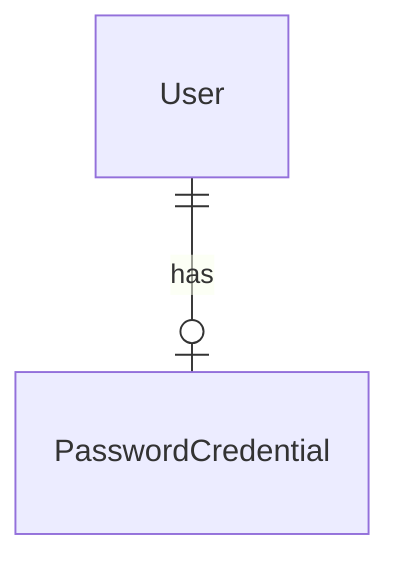

# Password credential foundation — Task 2.3

Task 2.6 denies all normal runtime PasswordCredential persistence access. These
hashing services remain independent of persistence; guarded credential schema tests
use the separate fixture capability. Future Auth/rehash persistence needs a reviewed
narrow access path. See [RLS architecture](RLS.md).

## Implemented boundary

PasswordCredential persistence and internal password primitives are implemented.
Non-global IdentityModule exports PasswordPolicy and PasswordHasher. The native
engine and capacity service are private module providers. AppModule imports this
module explicitly; it opens no database clients, HTTP routes or background jobs.
There are no registration/login/logout, password-change/recovery, session,
verification-email, role, tenant-switching or onboarding workflows. Credential
persistence has no public repository, DTO, resolver or controller. Future internal
use cases must import IdentityModule and DatabaseModule explicitly and narrowly
select credential columns. Never return a generated persistence model publicly.

## Dependency assessment

Production dependency is exactly `argon2@0.45.2`. Registry metadata and the
integrity-matched published tarball were inspected before installation. The
package declares Node >=16.17; its bundled README describes testing on Node >=22.
Node 24.22.3 satisfies both. It publishes CommonJS with named exports and bundled
argon2.d.cts declarations; actual ESM loading, strict TS6 compilation and native
hash/verify succeeded on Windows x64. No extra type package is needed.

The tarball bundles N-API 8 binaries for Windows x64 and Linux x64 glibc/musl,
among other platforms. Linux CI uses Ubuntu/Node24, matching the documented
Ubuntu22-or-newer prebuild target. Linux execution was not performed locally;
GitHub Actions remains unexecuted by this agent.

The install hook is `cross-env ZERO_AR_DATE=1 node-gyp-build`; loader/build
dependencies are @phc/format, cross-env, node-addon-api and node-gyp-build.
Only six lockfile entries were added (including cross-env's @epic-web/invariant
dependency); all existing versions and integrity values and the Prisma Effect
override are unchanged. Package metadata's development tools are not application
dependency requirements.

Six existing cross-spawn dependency entries lost their devOptional flags because
cross-env now makes them production dependencies; their locked versions and
integrities are unchanged.

Existing npm11 script protections reported six uncovered dependency hooks,
including argon2. No hook approval, allowScripts change, global policy relaxation
or build toolchain installation occurred. The packaged native binary loaded and
worked without approving the hook. On another platform, if a bundled binary
cannot load, stop for review before granting hook/build permissions or installing
a toolchain. Do not bypass protections or silently switch versions.

Before/after npm audit: 18 moderate, one high, zero critical, same affected
packages. No new finding was attributed to the added dependency. No unrelated
remediation was attempted. Existing production GraphQL advisory remains blocking.

References: [upstream Argon2 implementation](https://github.com/ranisalt/node-argon2),
[upstream tagged implementation](https://github.com/ranisalt/node-argon2/blob/v0.45.2/argon2.cjs),
[OWASP password storage guidance](https://cheatsheetseries.owasp.org/cheatsheets/Password_Storage_Cheat_Sheet.html),
[NIST password guidance](https://pages.nist.gov/800-63-4/sp800-63b.html).
This foundation does not claim NIST compliance or complete production policy.

## Persistence



| Field             | Type / behavior                                                             |
| ----------------- | --------------------------------------------------------------------------- |
| userId            | Native UUID, primary key and FK to User.id; no second credential identity   |
| passwordHash      | varchar(512), encoded Argon2id PHC; nonblank SQL CHECK                      |
| passwordChangedAt | timestamptz(3), default database now; actual password selection/change time |
| createdAt         | timestamptz(3), default now                                                 |
| updatedAt         | timestamptz(3), default now and Prisma @updatedAt                           |

Using the existing user UUID as the shared primary key is the simplest zero-or-one
relationship: a user may have no password credential; duplicates are impossible.
It needs no generated second UUID, tenantId or redundant FK index. FK deletion
and update both RESTRICT, preserving existing user-deactivation/history policy.
No salt, algorithm, plaintext, confirmation or reversible encryption columns.
Salt and parameters already live in the PHC string. Prisma maintains updatedAt
only for Prisma writes; direct SQL writers have the same explicit obligation as
other identity models. The database bounds storage, while the service validates
the encoded algorithm/parameters before any native verification.

Migration `20261126200000_password_credential` adds one table, its primary key,
one restricted FK and one nonblank CHECK in a PostgreSQL DDL transaction. The first
identity migration is unchanged. The new SQL was generated by diffing the
unchanged committed Task 2.2 Prisma schema against the new schema. An initial
migration-directory diff was refused because it requires a shadow URL; no shadow
was configured/created, and generation switched to datasource-free schema diff.
Never use from-empty to generate an incremental migration.

Both actual targets and existing migration/record fingerprints were checked
before application. Deployment and all 56 DB tests succeeded on guarded
hanoflow_test first. Development was then rechecked and the identical reviewed SQL
deployed. Both migration statuses are up to date and schema diffs empty. Existing
records and the first migration checksum are preserved; no reset, extension,
credential/privilege change or volume deletion occurred.

## Hashing and verification API

- `hash(password)` validates structural creation policy and returns the encoded
  PHC string. It explicitly uses Argon2id v19, memory 65536 KiB, time 3,
  parallelism 1, output 32 bytes; the library generates a cryptographically random
  16-byte salt. Native async operations use libuv, not synchronous event-loop work.
- `verify(password, encoded)` returns match with needsUpgrade, mismatch,
  invalid-hash, unsupported-hash or invalid-input. No credential or submitted
  values appear in results. It calls the library's verification implementation;
  there is no application-level password-hash comparison.
- `needsUpgrade(encoded)` inspects a bounded supported hash; invalid/unsupported
  hashes throw a sanitized PasswordHashRejectedError. Detection never writes data.

Before native work, a strict maximum-512-character PHC parser validates canonical
unpadded base64, algorithm/version, salt/output sizes and integer costs. The
supported verification window is Argon2id v19, memory 19456–65536 KiB, time 2–3,
parallelism 1, output 32 bytes, salt 16–32 bytes. The lower memory/time boundary
follows OWASP's Argon2id minimum; it is a compatibility floor, not a new-hash
setting. The tested older profile is 19456/2/1. Other algorithms, versions, excess
or below-floor costs and unsupported PHC extensions are rejected before native
allocation. Changing this window requires a separate security review.

Any supported memory/time below the current profile flags a future upgrade after
successful verification. New hashes always retain the approved candidate costs;
no security parameters were reduced for tests or benchmarks. All options and
capacity limits are fixed reviewed constants; there are no environment overrides.

Native failure throws sanitized PasswordOperationError with no raw cause;
capacity exhaustion throws PasswordCapacityError. These are operational failures,
distinct from password mismatch. Services do not log or write audit metadata.
Public response mapping, dummy-hash timing defenses for unknown accounts and
enumeration/rate controls belong to future authentication integration.

## Password policy and Unicode contract

Creation requires 15–128 Unicode code points and at most 512 UTF8 bytes. Spaces,
Unicode and password-manager strings are accepted. Combining marks and emoji
sequence components count as individual code points, not grapheme clusters.
Unpaired UTF16 surrogates are rejected to avoid lossy UTF8 replacement.

No trimming, case conversion, Unicode normalization, composition rules, truncation
or routine rotation exists. Identical visible strings with different Unicode
normalization forms remain distinct passwords. This is the owner's explicit
no-transformation contract; it is not a claim of full NIST policy compliance.

Existing-password verification uses only valid lossless UTF8 and a hard 1024-byte
resource bound, not the current creation minimum/maximum. Supported historical
short passwords can still verify. Oversized inputs fail before native work.

**Compromised/common-password screening is not implemented.** Structural
PasswordPolicy is not a complete production password policy. The future creation,
change and recovery use cases must run structural validation, then an explicitly
reviewed compromised/common-password screen, then hashing outside a DB transaction.
Screening must not be added to existing-password verification. An offline dataset
or an external service/privacy/failure contract requires owner approval; no dataset,
dependency, outbound password lookup or pretend successful screening was added.

## Hash upgrades and concurrency control

No credential persistence operation is part of PasswordHasher. A future rehash
must run only after successful verification, outside an open DB transaction.
Persist with a conditional update matching userId **and the previously read
passwordHash**, optionally updatedAt. A zero update count means a newer password
won the race: discard the stale rehash. Update passwordHash/updatedAt only, keeping
passwordChangedAt unchanged. An actual password-change use case updates
passwordChangedAt explicitly and handles future session revocation separately.
Real DB tests demonstrate preserved change time and stale conditional-update
rejection; no login/change/automatic rehash workflow is implemented.

## Resource capacity

Each Nest application instance admits one active native hash/verify operation,
two FIFO waiters and no more. Waiting expires after 1000 ms; overflow/timeouts
produce controlled capacity errors. Hash and verify share the same provider.
Capacity is released on success/failure. An expired waiter never starts work and
never releases the still-occupied active slot. No active-operation Promise.race
pretends to cancel native work or opens another slot while it continues.

Module teardown rejects queued/new work; already admitted native work finishes
and releases its slot. Active native jobs cannot be safely cancelled. Future
request cancellation/shutdown integration must respect this fact. Capacity is
local to the Nest application, not distributed admission control. Replicas and
multiple application contexts multiply memory demand. JavaScript strings cannot
be reliably zeroized; keep passwords short-lived and out of diagnostics.

Recommend the implemented one-active/two-waiting setting initially: about 64 MiB
Argon2 work memory per active job, modest local latency and bounded backlog. Raise
only after representative deployment memory/CPU/load testing and security review;
this does not replace future per-client/account abuse limits.

## Actual Windows benchmark

Command: `npm run build`, then `npm run benchmark:passwords`. The benchmark creates
only an offline IdentityModule context and synthetic runtime inputs; it emits
aggregate metrics, never passwords or PHC strings, and closes normally.

Node 24.22.3/npm 11.19.1; Windows x64 10.0.19045; Intel Core i7-10750H @2.60 GHz,
12 logical CPUs, 24370 MiB system RAM; default libuv pool 4. Existing Console Ninja
instrumentation was present. One hash/verify warmup precedes 20 sequential samples
of each operation using unchanged production parameters.

| Operation | Samples | Median    | p95 (nearest rank) | Maximum   |
| --------- | ------- | --------- | ------------------ | --------- |
| Hash      | 20      | 146.35 ms | 174.27 ms          | 176.57 ms |
| Verify    | 20      | 146.79 ms | 182.46 ms          | 195.58 ms |

Four simultaneous submissions: three completed through the one-active/two-waiting
gate, one immediately rejected for capacity, total 421.25 ms. Native concurrency
stayed capped at one (unit tests independently measure the concurrency invariant).
Process RSS baseline 102.52 MiB, sampled peak 165.44 MiB, final 101.44 MiB, sampled
every 5 ms. RSS includes the whole benchmark process; brief peaks may be missed.
This small local sample and one burst are not production capacity/tail-latency
guarantees. No parameter weakening is warranted by these measurements.

## Verification and manual use

All 212 prior tests remain with the identity catalog expectations extended for the
new approved table/migration. Added 36 offline tests and 10 real PostgreSQL tests.
No test requires Redis/PostgreSQL in the default offline layer. DB cleanup touches
only run-owned UUIDs, deleting credential fixtures before their users. Credential
DB-error assertions retain only machine codes, avoiding Prisma argument leakage.

For local review with Node24 and healthy existing services:

```sh
npm run db:validate
npm run db:generate
npm run typecheck
npm run lint
npm run format:check
npm test
npm run test:db
npm run redis:test:inspect
npm run test:redis
npm run build
npm run benchmark:passwords
```

Migration is a separate reviewed action before tests, never application startup.
Follow the existing guarded test-first deployment instructions in IDENTITY.md,
preserving distinct development/test URL values. Never reset or run db push.
Do not inspect/copy password hashes into terminal output, screenshots or Studio
exports. Inspect schema/timestamps only when manually reviewing this table.
See PROGRESS.md for exact executed results and preserved infrastructure.

No CI change was necessary: existing npm ci, Node24 and test-database migration
steps cover this dependency/schema. Actual Linux native loading awaits a GitHub
run. Existing production restrictions and compromised-password screening remain
unresolved. Task 2.4 now adds the separate internal session foundation described in
SESSIONS.md; public authentication workflows remain future. Task 2.5 adds internal
authorization as described in AUTHORIZATION.md. Task 2.6 requires
separate scope and explicit approval.
