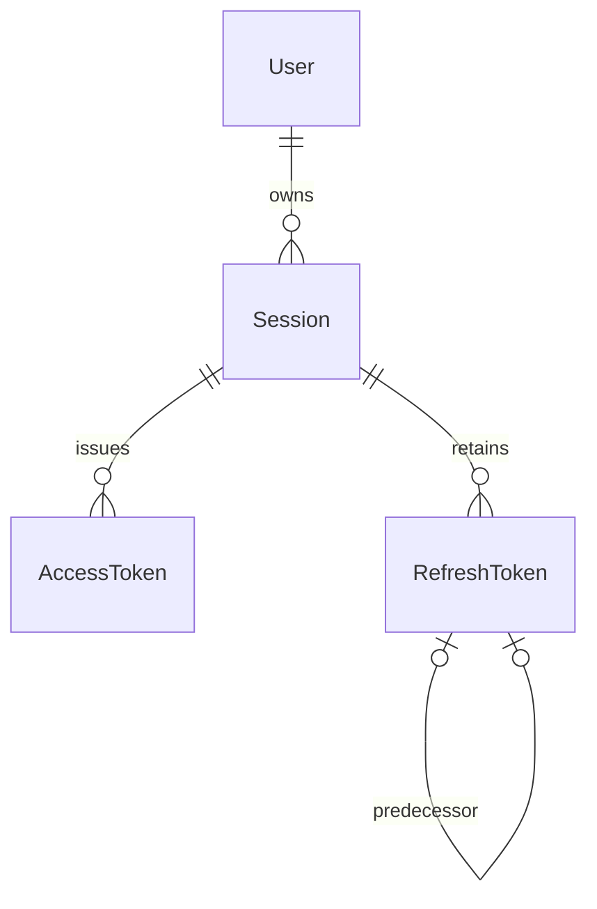

# Session management foundation — Tasks 2.4 and 2.5

## Implemented boundary and decisions

PostgreSQL is authoritative for identity-only and tenant-bound opaque sessions. Non-global
SessionsModule exports only SessionsService, imports DatabaseModule and AuditModule,
and is explicitly imported by AppModule. TokenSecrets and all persistence helpers
are private implementation details. Identity/password services have no dependency
on Sessions; there is no circular module reference or extra feature Prisma client.
AuditModule exports a narrowly typed transactional SessionAuditWriter.

No public login/logout/registration/refresh, HTTP/GraphQL guards, cookies, bearer
transport, public tenant switching/role management, platform elevation, RLS, distributed rate
limits, Redis authority/cache, scheduled cleanup or business workflows are added.
Existing production restrictions remain unchanged. Task 2.5 adds internal tenant context
and RBAC; see AUTHORIZATION.md for the current credential, eligibility and lock contracts.
Task 2.6 has not started.

Session scope supports IDENTITY with null tenant/member references or TENANT with
consistent user/tenant/member composite references. contextVersion starts at one,
is positive and checked against access and refresh tokens. Internal selectTenant
requires both current credentials, rotates them and increments the version in a
transaction. No platform context is available. AUTHORIZATION.md defines runtime
trusted contexts, strict replay and race semantics.

Current eligibility requires User ACTIVE **and nonnull emailVerifiedAt**, checked
from current database state at establishment, access validation and refresh.
Other states and unverified addresses are rejected. This is the selected safe
foundation policy, not an email-verification workflow. Future support for an
unverified identity-only onboarding context requires explicit policy review.

## Models and relationships



| Model        | Fields                                                                                                                                                                                        |
| ------------ | --------------------------------------------------------------------------------------------------------------------------------------------------------------------------------------------- |
| Session      | UUID id; required userId FK; scope IDENTITY; client BROWSER/MOBILE; positive contextVersion; createdAt, lastActivityAt, idleExpiresAt, absoluteExpiresAt; nullable revokedAt/revocationReason |
| AccessToken  | UUID id; sessionId FK; unique 32-byte digest; positive contextVersion; createdAt/expiresAt                                                                                                    |
| RefreshToken | UUID id; sessionId FK; unique 32-byte digest; createdAt/expiresAt; nullable consumedAt; nullable unique predecessorId with same-session composite FK                                          |

New identifiers use PostgreSQL gen_random_uuid(), matching existing UUIDv4
conventions. All timestamps are timestamptz(3). There is no redundant updatedAt:
activity, consumption and revocation timestamps express the actual state changes.
All four new FKs use ON DELETE/UPDATE RESTRICT, preserving history. Records have
no raw secret columns. Access tokens need no per-row revocation flag because every
validation checks the authoritative session. Older access tokens remain valid
until their own expiry or session/user/context invalidation, including after refresh.

Database-enforced invariants:

- Session: createdAt <= lastActivityAt < idleExpiresAt <= absoluteExpiresAt;
  contextVersion > 0; revokedAt/reason are both null or both present; revocation
  cannot predate creation. Reason enum EXPLICIT/REVOKE_ALL/REFRESH_REPLAY.
- AccessToken: exactly 32 digest bytes, unique digest, createdAt < expiresAt,
  positive contextVersion and existing Session.
- RefreshToken: exactly 32 digest bytes, unique digest, createdAt < expiresAt;
  consumedAt null or createdAt <= consumedAt < expiresAt; no self predecessor;
  unique predecessor permits at most one successor; composite
  (sessionId,predecessorId) -> (sessionId,id) prevents cross-session lineage.
- Partial unique index on sessionId WHERE consumedAt IS NULL permits at most one
  unconsumed refresh token, even if expired. Rotation consumes before inserting.
  There is no independently usable parallel refresh branch.

Indexes: Session (userId,revokedAt,id), idleExpiresAt, absoluteExpiresAt;
AccessToken unique digest, sessionId, expiresAt; RefreshToken unique digest,
unique predecessorId, unique (sessionId,id), expiresAt and the partial session key.
There are fourteen new indexes including primary keys, ten SQL-only CHECKs and
four restricted FKs. Catalog/behavior tests verify these alongside prior invariants.

Service-enforced cross-row invariants: issued token expiry is clipped to applicable
session boundaries; predecessor is consumed before successor issuance; successor
creation/consumption chronology; lineage is append-only through this API; idle
extension preserves absolute lifetime. Direct SQL/other future writers must obey
these rules too. SQL constraints do not enforce arbitrary lineage acyclicity or
session/token cross-row lifetime comparisons. No update/delete lineage API exists.
Database access permissions and retention/immutability enforcement remain future.

## Token format and cryptography

TokenSecrets generates 32 random bytes using Node crypto.randomBytes. The random
component is canonical unpadded Base64URL (43 characters), prefixed hfa_ for access
or hfr_ for refresh, giving exactly 47 characters. The public purpose label adds
no entropy; the secret has 256 random bits. It is neither a UUID nor Math.random.
Strict length/alphabet checks plus decode/re-encode equality reject noncanonical
encodings before database work. Wrong-purpose substitution fails before lookup.

SHA-256 of the full purpose-prefixed token is stored as a unique binary 32-byte
digest in the purpose-specific table. TypeScript uses explicitly allocated
Uint8Array<ArrayBuffer> values compatible with Prisma7/TS6 Bytes; no unchecked
Buffer type casts. Database octet_length checks prevent short/long values.

High-entropy random secrets do not have human password guess distributions:
SHA-256 permits indexed lookup while a 256-bit preimage remains infeasible.
Argon2id remains appropriate for low-entropy human passwords and is unchanged.
The raw token cannot be recovered from its digest. No raw token/digest is logged,
returned in validation contexts, placed in audit metadata or emitted by tests.
Only the narrow IssuedSession internal result carries new raw credentials, after
successful transaction commit. No cache or recovery mechanism retains them.

References: [Node24 crypto](https://nodejs.org/docs/latest-v24.x/api/crypto.html),
[PostgreSQL row locking](https://www.postgresql.org/docs/18/explicit-locking.html),
[PostgreSQL authoritative time](https://www.postgresql.org/docs/18/functions-datetime.html).

## Lifetime and activity policy

| Client  | Access     | Idle       | Absolute |
| ------- | ---------- | ---------- | -------- |
| Browser | 10 minutes | 30 minutes | 12 hours |
| Mobile  | 10 minutes | 7 days     | 30 days  |

Defaults are fixed validated constants, with no environment or caller-supplied
duration overrides. The policy validator rejects nonpositive/noninteger values,
access > idle, idle > absolute, access beyond 10 minutes or absolute beyond 30 days.
Only the reviewed client classification selects a profile; a future transport must
derive that classification at its trusted boundary, not accept arbitrary lifetimes.

Establishment sets activity/idle/absolute. Only successful refresh extends activity
and idle; access validation is read-only and writes no activity or audit event.
Idle becomes min(database now + idle duration, existing absolute). Access expires
at min(now + 10 minutes, new idle, absolute); refresh expires at new idle. Refresh
never extends absolute expiry. Expired means now >= expiresAt, deterministically.

Every operation uses PostgreSQL clock_timestamp(), truncated to milliseconds,
sampled after locks are acquired. Transaction-start CURRENT_TIMESTAMP would be
stale after waiting for a lock. One sampled instant governs each state transition.
Host/client timestamps do not govern authorization. Future clock synchronization
and monitoring remain operational requirements; this is not monotonic-clock magic.

## Trusted establishment and validation

`establish(identity, client, correlationId)` is internal only. AuthenticatedIdentity
is a TypeScript trust contract, **not cryptographic proof** or runtime permission.
Future Auth must authenticate through an approved flow, enforce abuse/security
checks and construct this input from trusted state. Never map a request user ID
directly into it. The service still revalidates current user state under a lock.

Session, both digests and safe establishment audit commit atomically. Failure
rolls back all three records and the audit; raw credentials are never returned
on rollback or uncertain commit. Secure random generation/SHA work is tiny; no
password hashing, external service, Redis operation or user/network wait belongs
inside these transactions. Test-only gates verify commit behavior explicitly.

`validateAccess(raw)` checks syntax/purpose, indexed digest, current User and
Session, access/session idle/absolute expiry and contextVersion. It returns only
userId/sessionId/IDENTITY/contextVersion or an internal invalid result. It neither
returns credential records nor asserts tenant/role authorization. Future protected
REST/GraphQL integration must obtain tokens through reviewed transport/CSRF/cookie
policies, normalize public failures and build trusted request identity explicitly.

Validation holds shared User then Session locks while checking state. Validity is
at that database authorization point; revocation does not retroactively cancel
already authorized/executing requests. Sensitive business operations must recheck
applicable identity/authorization transactionally with their actual writes.

## Transaction and lock strategy

All lifecycle operations use Prisma interactive READ COMMITTED transactions with
maxWait 1000ms and timeout 5000ms. Existing pool max5, connection timeout2s,
statement_timeout2s and query_timeout3s are unchanged. SET LOCAL lock_timeout=750ms
bounds contended lock waits below statement/transaction limits. No unbounded wait,
pool expansion, in-process mutex or automatic transaction retry is used.

Order: User row, Session row, sorted Tenant rows, Membership rows, RefreshToken row;
revoke-all locks Sessions in ID
order after the User. Establishment locks User exclusively before inserting.
Refresh/revocations lock User and Session FOR UPDATE. Validation uses FOR SHARE.
Current user-state updates also conflict with those row locks. All future session
writers must retain the same order. Private lookup discovers IDs before locking;
refresh rereads token state under lock and current session/user state after waits.

This conservative strategy serializes lifecycle writes even across independent
sessions for the same user, simplifying revoke-all/session-creation semantics.
Different users progress independently; concurrent shared validations can coexist.
Capacity, pool wait and hot-user load need production measurement before tuning.
No claim is made that arbitrary external SQL writers obey the service lock order.

On refresh: locate token/session, lock User -> Session -> token, sample database
time, recheck eligibility/expiry/consumption, consume parent, extend activity,
insert exactly one successor and access digest, audit rotation, commit, then
return raw credentials. Row locking plus unique constraints enforce the result
across multiple backend instances. Real tests use two independent application
pools/backend connections, not a mocked transaction or local mutex.

Every transaction error becomes sanitized SessionOperationError without raw cause,
credentials or Prisma diagnostics. A lost connection around commit is ambiguous:
the caller receives no tokens and the service does not blindly retry. A future
transport must require safe reauthentication/recovery; it cannot recover raw
tokens from PostgreSQL. Operational telemetry must report safe codes only.

## Strict replay and revocation semantics

A known consumed refresh token on a still relevant session revokes that session
with REFRESH_REPLAY and records a DENIED audit **in the same transaction**. The
transaction returns a replay value, rather than throwing and rolling back. Prisma
commit completes before the caller receives that value. If audit/commit fails,
the operation reports an operational failure instead of claiming durable replay
handling. There is no grace window.

- Two concurrent legitimate uses: exactly one rotates; the serialized second use
  is replay and revokes the session, including the winner's new credentials.
- Lost successful response: retrying the consumed predecessor revokes the session;
  new raw tokens cannot be recovered. Clients need single-flight refresh and
  reauthentication after an uncertain/lost rotation response.
- Expired consumed predecessor, still-live session: replay still revokes. Session
  relevance is checked before the consumed token's own expiry.
- Expired or already revoked session: invalid result; no duplicate revocation or
  unbounded repeat audit. Consumed history is retained.
- Unknown random token: invalid result, no unrelated revocation and no audit flood.

`revoke(identity, sessionId, correlationId)` affects only that user's matching
session and is idempotent. `revokeAll(identity, correlationId)` revokes currently
unrevoked sessions for that user; a repeat changes/counts zero and creates no
repeat audit. Other users are untouched. Trusted future callers must separately
authorize these commands; they are not public logout/session-management APIs.

Revoke-all versus establishment is serialized by the same User lock. A creation
committing before revoke-all is included; a creation ordered afterward survives.
This is point-in-time revocation, not a permanent sign-in ban or automatic password
credential change. Future password-change/security workflows must define their
own eligibility/generation barriers if they require stronger semantics.

## Audit policy and sensitive data

Events: session.established, session.rotated, session.revoked,
session.revoked_all, session.refresh_replay. All are PLATFORM audit namespace
events with null tenant, server-assigned correlation UUID and safe Session/User
target UUID. Authenticated operations reference the user actor; replay detection
uses a null system actor because a consumed token does not authenticate its
presenter. The Session target preserves ownership context without falsely naming
the presenter. PLATFORM audit scope conveys no elevated session.
Metadata is constructed from an allowlist: establishment client enum, revoke-all
nonnegative changed count, otherwise no metadata. No arbitrary request data,
tokens, digests or password values are accepted by this writer contract.

Security state and events commit atomically. Every rotation adds one event; invalid
random requests/read-only validation add none, idempotent revocations add no repeat.
Session/access/refresh/audit growth needs reviewed limits, retention and cleanup
before production. Do not delete consumed history while relevant sessions can
still need replay detection. No cleanup jobs, audit APIs or database append-only
permissions were implemented; audit immutability is not claimed.

## Migration, testing and manual review

Third migration: 20261126210000_sessions_and_tokens. Generated from unchanged prior
Prisma schema to current schema using installed Prisma migrate diff; reviewed
additive SQL plus ten custom CHECKs/one partial unique index wrapped in BEGIN/COMMIT.
No shadow database, reset, db push, extension, new role/credential or privilege
change. Both prior applied migrations remain byte-identical.

Actual database identity/history/schema/data fingerprint checks preceded migration.
Guarded test deployment and real integration tests passed before development was
rechecked and migrated with identical SQL. Both statuses are up to date and diffs
empty. Generated Prisma client remains ignored. See PROGRESS.md for exact counts,
durations, migration hashes and infrastructure preservation evidence.

Manual verification with Node24 and existing healthy guarded environments:

```sh
npm run db:validate
npm run db:generate
npm run typecheck
npm run lint
npm run format:check
npm test
npm run test:db
npm run redis:test:inspect
npm run test:redis
npm run build
```

For focused real session checks: `npm run test:db -- --testPathPatterns=sessions.database-spec`.
These tests create synthetic ACTIVE/verified users and clean only run-owned IDs
and correlations, including child-first refresh lineage cleanup. They must never
operate on development or production. Do not print/export persisted digests or
raw issued results through Studio, scripts, snapshots or debugging.

Public transport, guards, authenticated trust construction, browser/mobile client
single-flight behavior, CSRF/cookie storage, abuse defenses, compromised-password
screening, retention/cleanup, tenant authorization/RLS and existing deployment
restrictions remain future requirements. No new dependency or CI job is needed;
GitHub Actions execution is separate from local acceptance.
